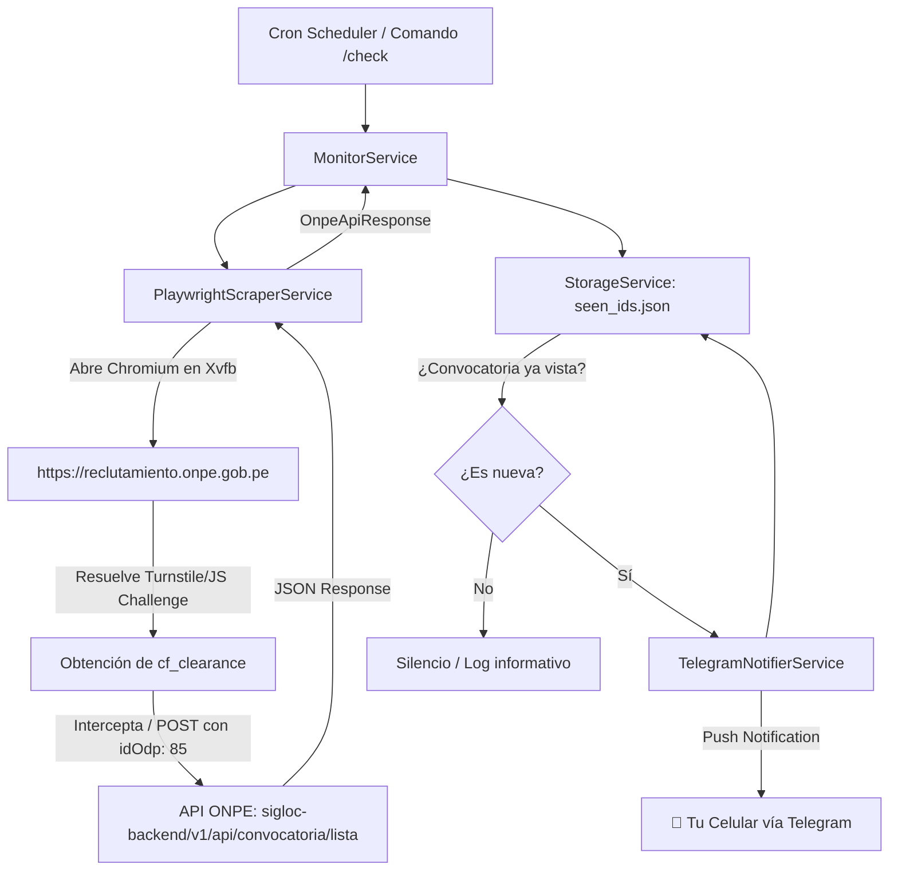

# 🤖 ONPE Alertas Bot - Monitor de Convocatorias en Tiempo Real

Sistema automatizado en **TypeScript / Node.js** diseñado para vigilar y alertar la publicación de ofertas laborales (locación de servicios y CAS) en el portal de reclutamiento oficial de la **ONPE (Oficina Nacional de Procesos Electorales del Perú)**.

Cuenta con evasión de la protección antibot de **Cloudflare (Managed Challenge / Turnstile)** mediante Chromium Headless con **Xvfb (Virtual Framebuffer)**, notificaciones en tiempo real vía **Telegram** y control interactivo mediante comandos en el chat.

---

## 📑 Tabla de Contenidos

- [Características Principales](#-características-principales)
- [Arquitectura del Sistema](#-arquitectura-del-sistema)
- [Estrategia Antibot (Cloudflare Bypass)](#-estrategia-antibot-cloudflare-bypass)
- [Estructura del Proyecto (SOLID)](#-estructura-del-proyecto-solid)
- [Comandos Interactivos de Telegram](#-comandos-interactivos-de-telegram)
- [Variables de Entorno](#-variables-de-entorno)
- [Despliegue en Dokploy (Paso a Paso)](#-despliegue-en-dokploy-paso-a-paso)
- [Pruebas en Local](#-pruebas-en-local)
- [Resolución de Problemas Frecuentes (FAQ)](#-resolución-de-problemas-frecuentes-faq)

---

## 🚀 Características Principales

- **Bypass Automático de Cloudflare:** Carga la sesión en una instancia de Chromium bajo un servidor de pantalla virtual (Xvfb) con huella *stealth* para superar retos antibot sin requerir servicios de pago externos.
- **Estrategia Dual de Extracción:** Intercepta la llamada natural de Angular o ejecuta una consulta autenticada desde el contexto del navegador aprovechando la cookie `cf_clearance`.
- **Filtro por ODPE / Sede:** Configurado por defecto para la sede **SANTA (ID: `85`)**, parametrizable mediante variables de entorno para cualquier otra sede del Perú.
- **Detección Inteligente de Novedades (Anti-Spam):** Almacena el historial de convocatorias notificadas en un archivo persistente (`seen_ids.json`), garantizando que solo se reciba una notificación por cada plaza nueva.
- **Control Remoto desde Telegram:** Permite forzar consultas inmediatas (`/check`), modificar la cadencia de escaneo (`/time <min>`), y consultar el estado del servicio (`/status`) sin reiniciar contenedores ni acceder al servidor.
- **Seguridad en Chat:** Valida el `TELEGRAM_CHAT_ID` del remitente, rechazando comandos de usuarios no autorizados.

---

## 🏗️ Arquitectura del Sistema

El flujo de ejecución sigue una arquitectura desacoplada basada en principios **SOLID**:



---

## 🛡️ Estrategia Antibot (Cloudflare Bypass)

El backend de la ONPE (`/sigloc-backend/v1/api/convocatoria/lista`) se encuentra protegido por Cloudflare WAF. Un script tradicional (`curl`, `axios`, `fetch`) recibe inmediatamente un bloqueo `HTTP 403 Forbidden` con el script de comprobación JavaScript.

### ¿Cómo lo resuelve el bot?

1. **Xvfb en Docker:** Se ejecuta un servidor gráfico virtual en memoria (`Xvfb :99`), lo que permite que Chromium corra en modo interfaz real (`headless: false`) dentro del contenedor Linux sin depender de monitores físicos.
2. **Parches Stealth:** Se eliminan las banderas `navigator.webdriver = true` e inyectan objetos de navegación estándar de Windows (`window.chrome`, User-Agent moderno, zona horaria `America/Lima`).
3. **Estrategia Dual de Fetch:**
   - **Estrategia A (Intercepción Angular):** Intercepta la petición HTTP que la aplicación SPA Angular dispara automáticamente al cargar la vista y reemplaza el payload por el `idOdp` configurado.
   - **Estrategia B (Fallback Contextual):** Si Angular no dispara la llamada a tiempo, ejecuta una llamada `fetch()` dentro del DOM del navegador utilizando las credenciales y cookies activas de la sesión.

---

## 📁 Estructura del Proyecto (SOLID)

```text
onpe-bot-alertas/
├── data/
│   └── seen_ids.json            # Base de persistencia de convocatorias vistas
├── docs/                        # Documentación adicional y guías
├── src/
│   ├── config/
│   │   └── env.ts               # Validación y tipado estricto de variables de entorno
│   ├── services/
│   │   ├── command-listener.service.ts # Escucha de comandos Telegram (/time, /check, etc.)
│   │   ├── monitor.service.ts          # Orquestador del ciclo de verificación y alertas
│   │   ├── notifier.service.ts         # Integración de mensajería con la Telegram Bot API
│   │   ├── scraper.service.ts          # Automatización de Chromium y evasión de Cloudflare
│   │   └── storage.service.ts          # Persistencia en disco (IStorageService)
│   ├── types/
│   │   └── convocatoria.ts      # Interfaces TypeScript de la API de la ONPE
│   ├── index.ts                 # Punto de entrada principal y scheduler dinámico
│   └── test-request.ts          # Script para pruebas locales rápidas
├── docker-entrypoint.sh         # Inicializador de Xvfb y proceso Node.js en contenedor
├── Dockerfile                   # Imagen multi-stage optimizada con Playwright v1.64.1
├── docker-compose.yml           # Definición para despliegues con volumen de datos
├── package.json
└── tsconfig.json
```

---

## 🎮 Comandos Interactivos de Telegram

Puedes enviar estos comandos en cualquier momento directamente al bot ([@ONPECHAMBA_BOT](https://t.me/ONPECHAMBA_BOT)):

| Comando | Descripción | Ejemplo |
| :--- | :--- | :--- |
| **`/check`** | Fuerza una verificación manual e inmediata contra el servidor de la ONPE y responde en el chat con los resultados. | `/check` |
| **`/time <min>`** | Modifica dinámicamente el intervalo del temporizador en memoria sin reiniciar el bot. | `/time 2` (cada 2 min)<br>`/time 30` (cada 30 min) |
| **`/status`** | Muestra el estado operativo, la ODPE vigilada, última hora de revisión y cantidad de convocatorias monitoreadas. | `/status` |
| **`/help`** | Despliega la guía de comandos disponibles. | `/help` |

> [!NOTE]
> Cuando el bot realiza sus comprobaciones automáticas periódicas y **no encuentra convocatorias nuevas**, se mantiene en silencio para no saturar tu bandeja. Solo enviará notificaciones si detecta una plaza que no haya sido registrada previamente.

---

## ⚙️ Variables de Entorno

Configura estas variables en tu archivo `.env` o en el panel de tu orquestador (**Dokploy**):

```env
# Token otorgado por @BotFather (Debe incluir el ID numérico y los dos puntos)
TELEGRAM_BOT_TOKEN=8851592724:AAE34JIA-ntfzZh1Ep554a5EuG9G3VH65Ts

# Tu ID numérico de Telegram (consultado en @userinfobot)
TELEGRAM_CHAT_ID=6186519218

# Código ID de la ODPE en el portal de la ONPE (85 = SANTA)
ONPE_ID_ODP=85

# Nombre referencial de la ODPE para los mensajes
ONPE_ODP_NOMBRE=SANTA

# Expresión cron para el ciclo por defecto (ej. cada 30 minutos)
CRON_SCHEDULE=*/30 * * * *

# Ruta del archivo de persistencia dentro del contenedor
DATA_PATH=/app/data/seen_ids.json

# Modo headless (false para utilizar la pantalla virtual Xvfb y burlar Cloudflare)
PLAYWRIGHT_HEADLESS=false
```

---

## 💻 Despliegue en Dokploy (Paso a Paso)

### 1. Ajustes en la aplicación de Dokploy
1. Ingresa a tu panel de Dokploy y selecciona la aplicación.
2. En la pestaña **General**:
   - **Build Type:** Selecciona **`Dockerfile`**. *(Evita Nixpacks, ya que Playwright requiere binarios del sistema para navegadores).*
3. En la pestaña **Environment**:
   - Pega las variables descritas arriba asegurándote de que `PLAYWRIGHT_HEADLESS=false` y `DATA_PATH=/app/data/seen_ids.json`.
4. En la pestaña **Volumes**:
   - Agrega un volumen persistente apuntando a `/app/data` para que el archivo `seen_ids.json` sobreviva a los reinicios y redeploys.

### 2. Subida del Código
Desde tu máquina local:
```bash
git add .
git commit -m "feat: bot onpe actualizado"
git push
```

### 3. Despliegue y visualización de logs
1. En Dokploy, haz clic en **Deploy / Redeploy**.
2. Dirígete a la pestaña **Logs**:
   - **IMPORTANTE:** En la esquina superior derecha activa el interruptor **`Native`** para visualizar la consola de Docker en tiempo real sin almacenamiento en búfer.

---

## 🧪 Pruebas en Local

Para comprobar que la petición a la ONPE funciona correctamente desde tu computadora antes de subir cambios:

```bash
# 1. Instalar dependencias
npm install

# 2. Descargar binarios de Chromium de Playwright (solo la primera vez)
npx playwright install chromium

# 3. Ejecutar prueba unitaria contra la API de la ONPE
npm run test:request
```

Este comando abrirá brevemente el navegador, resolverá la verificación con la ONPE, imprimirá la respuesta JSON cruda en consola y te mandará un mensaje de confirmación a tu Telegram.

---

## ❓ Resolución de Problemas Frecuentes (FAQ)

### 1. El bot no responde a mis mensajes en Telegram
- **Causa:** Telegram prohíbe que los bots inicien conversaciones.
- **Solución:** Debes abrir el chat con el bot ([@ONPECHAMBA_BOT](https://t.me/ONPECHAMBA_BOT)) y pulsar **Iniciar** o enviar `/start` al menos una vez.

### 2. Error: `Looks like Playwright was just updated. Please update docker image as well`
- **Causa:** Desincronización entre la versión del paquete `playwright` en `package.json` y la imagen base en `Dockerfile`.
- **Solución:** El `Dockerfile` utiliza `mcr.microsoft.com/playwright:v1.64.1-noble` coincidiendo con la versión de `package.json`.

### 3. En los logs de Dokploy sale "No logs found"
- **Causa:** Dokploy tiene el visor nativo desactivado o el proceso está buffering stdout.
- **Solución:** Activa el botón **Native** en la esquina superior derecha de la pestaña **Logs** de Dokploy.

### 4. ¿Por qué a veces el bot no habla cada 2 minutos?
- Si configuraste `/time 2`, el bot ejecuta la consulta silenciosamente cada 2 minutos. Si la ONPE devuelve 0 plazas activas en Santa, no enviará mensajes vacíos para evitar spam. Usa `/check` si deseas una respuesta explícita al instante.
